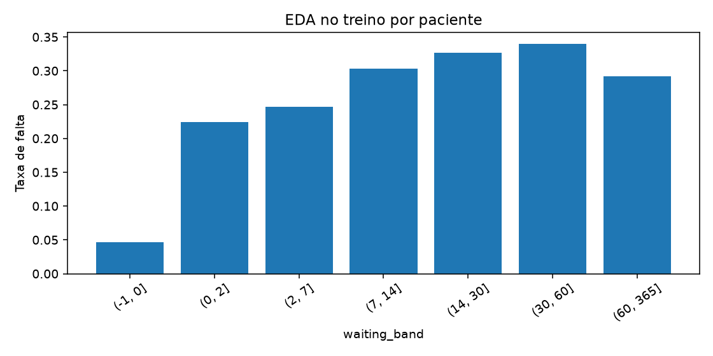

# Sprints 2 e 3 — baseline, histórico e análise exploratória

Execução em 05/11/2026 com `KaggleV2-May-2016.csv`, obtido pela API pública do dataset `joniarroba/noshowappointments`. Dados individuais permanecem ignorados pelo Git. Tabelas, métricas e gráficos agregados ficam em [`reports/sprints-2-3`](../reports/sprints-2-3/).

## Escopo e reprodução

A S2 já tinha as issues #5, #6 e #7 integradas. Esta entrega completa #8 e implementa #9, #10, #11 e #12 da S3. Random Forest, XGBoost, balanceamento, tuning e seleção final pertencem às próximas sprints.

```bash
python -m venv .venv
source .venv/bin/activate
pip install -r requirements.txt
# Colocar o CSV original em data/raw/, conforme README.
python -m unittest discover -s tests -v
python -m src.analysis
```

Os notebooks `01_eda.ipynb` e `03_modelagem.ipynb` apresentam as mesmas funções em etapas. O CLI gera artefatos sem precisar abrir Jupyter. Figuras usam backend Agg para execução sem interface gráfica. Não há reamostragem ou ajuste de hiperparâmetros nesta etapa.

## Partições e histórico

Após a limpeza existente: 109.889 consultas e 62.298 pacientes. A partição por paciente (seed 42) contém 87.720 consultas de treino e 22.169 de teste, sem pacientes compartilhados. A exploração da S3 e as correlações usam apenas o treino. A auditoria original da S1, preservada no início do notebook 01, descreve o arquivo completo.

O histórico conta consultas e faltas em dias **estritamente anteriores ao dia do agendamento**. Como falta horário da consulta, nem uma consulta no próprio dia entra. Consultas futuras e o alvo da própria linha não entram. Registros sem histórico têm contagem e taxa zero; a contagem permite distinguir essa situação de pacientes com presença prévia. Só 28,0% dos agendamentos têm algum histórico observável. Isso reflete a janela curta de consultas, não a vida inteira do paciente.

O histórico é calculado antes da partição, mas cada paciente pertence inteiramente a uma única partição. No teste, simula consultas sequenciais: desfechos anteriores já conhecidos no novo agendamento podem alimentar o histórico. Não é um cenário em que todos os scores são calculados de uma vez numa única data inicial.

A checagem temporal treina em consultas anteriores a 25/05/2016 e testa agendamentos a partir dessa data (70.856 e 22.908 linhas). Consultas pendentes no corte ficam fora do treino. Essa partição permite pacientes recorrentes. O fim da coleta em 08/06 favorece esperas curtas no teste e impede observar agendamentos com consultas posteriores ao fim da base. Portanto ela é uma checagem limitada por truncamento e janela curta, sem equivalência direta à partição por paciente.

## Baseline (#8)

Pré-processamento: escala nas variáveis numéricas e one-hot nas categóricas, ajustados exclusivamente no treino, com categorias desconhecidas toleradas. Regressão logística com limiar padrão 0,5, sem balanceamento. PR-AUC nesta entrega significa average precision (AP), não integração trapezoidal da curva.

| Partição | Modelo | AP | ROC-AUC | Precisão@20% | Recall@20% | Recall em 0,5 |
|---|---|---:|---:|---:|---:|---:|
| Paciente | Dummy (prior) | 0,2029 | 0,5000 | 20,29% | 20,00% | 0,00% |
| Paciente | Logística | 0,3036 | 0,6550 | 34,78% | 34,29% | 1,85% |
| Temporal | Dummy (prior) | 0,1180 | 0,5000 | 11,80% | 20,00% | 0,00% |
| Temporal | Logística | 0,2065 | 0,6067 | 18,79% | 31,87% | 2,74% |

A logística melhora o ranking, mas o limiar 0,5 recupera poucas faltas. Isso motiva avaliar balanceamento e limiares nas sprints seguintes. O dummy acerta 79,71% no teste por paciente prevendo sempre presença: essa acurácia não representa utilidade de contato. Empates no corte recebem captura esperada sob desempate aleatório; K é arredondado para cima.

## Perguntas de negócio (#10 e #11)

1. **Perfil:** taxa de falta no treino de 20,06%. Adolescentes de 13–18 anos: 25,93% (6.231 consultas); maiores de 60: 15,08% (15.625). Mulheres: 20,13% (57.021 consultas); homens: 19,92% (30.699). Os detalhes de sexo e bairro estão nas tabelas `rates_gender.csv` e `rates_neighbourhood.csv`. Grupos pequenos não sustentam rankings confiáveis de bairros.
2. **Cadastro e condições de saúde:** tabelas `rates_bolsa_familia.csv`, `rates_hypertension.csv`, `rates_diabetes.csv`, `rates_alcoholism.csv` e `rates_handicap.csv` mostram taxas e suporte. Bolsa Família: 23,43% com benefício contra 19,69% sem; hipertensão: 17,18% com contra 20,77% sem; diabetes: 17,92% com contra 20,22% sem; alcoolismo: 19,42% com contra 20,08% sem. Para deficiência, 18,26% com uma contra 20,09% com zero; duas ou mais têm suporte progressivamente menor (131, 11 e 3 consultas). São associações marginais; diferenças de idade e antecedência podem explicar parte delas. Não há evidência causal de efeito de benefício ou condição de saúde.
3. **Antecedência:** consultas no mesmo dia têm 4,61% de faltas (30.715 consultas), contra 30,36% com espera de 8–14 dias (9.608). A taxa não cresce indefinidamente: em mais de 60 dias é 29,20% (1.668). Ver gráfico abaixo.
4. **Dia da semana:** Segunda: 20,73%; terça: 19,86%; quarta: 19,43%; quinta: 19,13%; sexta: 21,21%. `rates_weekday.csv` e seu gráfico trazem os suportes; sábado tem suporte limitado, e o dataset não informa o horário da consulta.
5. **Histórico:** entre quem tem histórico observável e nenhuma falta anterior, a taxa é 13,37% (16.561 consultas); com uma falta anterior, 19,24% (5.930); com duas, 21,97% (1.270). Valores extremos têm suporte muito pequeno. A associação merece validação por ablação na S4.
6. **SMS:** não há SMS até 2 dias de espera. Nas faixas de 3–7, 8–14 e 15–30 dias, as taxas com SMS são 23,32%, 27,71% e 29,99%, contra 26,43%, 34,11% e 36,89% sem SMS. A estratificação reduz mistura por antecedência, mas não elimina confundimento ou demonstra causalidade. SMS permanece fora do modelo.
7. **Contato de 20%:** no teste por paciente, os 4.434 maiores scores da logística capturam 1.542 de 4.497 faltas reais (34,29%), contra 899,44 faltas esperadas em contato aleatório de igual tamanho. É desempenho retrospectivo de ranking.
8. **Recuperação hipotética:** aplicando e = 10%, 20% e 30% às 1.542 faltas capturadas, estimam-se 154,2, 308,4 e 462,6 consultas recuperadas. No contato aleatório: 89,94, 179,89 e 269,83. São expectativas condicionadas ao efeito assumido, sem intervenção medida.
9. **Equilíbrio econômico:** contato compensa se `p * e * valor_vaga > custo_contato`. Com custo hipotético de R$ 1,50, e = 20% e valor **ilustrativo** de R$ 100 por vaga, exige p > 7,5%. Não convertemos os US$ 37 históricos do README em reais sem uma hipótese cambial. Este baseline ainda não tem avaliação de calibração para decisão econômica individual.




## Seleção inicial (#12)

A lista explícita em `src/features.py` mantém idade, Bolsa Família, hipertensão, diabetes, alcoolismo, contagem de deficiências, espera, gênero, bairro, dia da semana e os três atributos de histórico como candidatos iniciais. Identificadores, datas brutas e SMS não entram. `same_day` é excluído por ser derivável de espera zero.

No treino, Spearman entre espera e falta é 0,284 e entre idade e falta é -0,064. Idade e hipertensão têm correlação 0,504. Contagem de faltas anteriores e taxa anterior são quase redundantes (0,998); esta entrega registra ambos como candidatos para futura ablação, sem selecionar pelo teste. Correlação baixa com o alvo não exclui relações não lineares ou interações. Categóricas recebem one-hot e não códigos numéricos para correlação. Não há seleção definitiva de variáveis nesta sprint.

## Validação

Seis testes automatizados passaram, o CLI foi executado no dataset completo e os notebooks 01 e 03 executaram até o fim com nbconvert. Testes verificam limpeza idempotente, isolamento por paciente, elegibilidade temporal, histórico em dados fora de ordem com índices repetidos, invariância à mudança do alvo futuro, pré-processamento sem categorias do teste e ranking do dummy com empates. As métricas e tabelas acima foram produzidas com dados reais. A política existente de conservar a primeira duplicata com alvo divergente é mantida como premissa, não como confirmação de que o desfecho conservado seja correto.

SHA-256 do CSV utilizado: `9132d3e7d0246617df9041d3764f20ad6f08e7b0d9f0997fa254fc5e52eda27d`.
