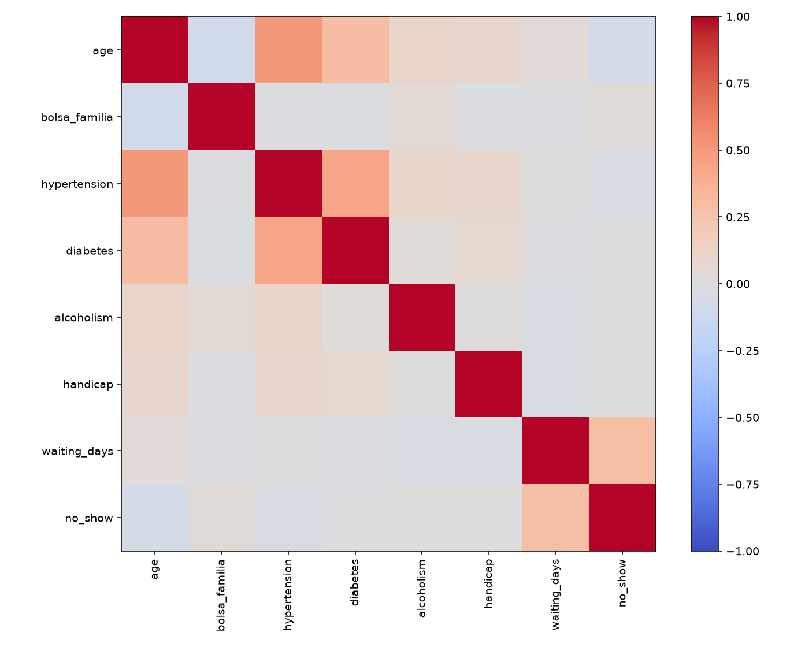

# Fernando — tarefas das sprints 2 e 3

Esta entrega cobre exclusivamente #8 (baseline ingênuo e regressão logística simples) e #12 (correlações e seleção inicial de variáveis).

## Reprodução

Com as dependências do requirements.txt instaladas e o CSV em data/raw/:

```bash
python -m unittest discover -s tests -v
python -m src.analysis
```

O notebook 03 apresenta os baselines e as correlações. Os artefatos agregados estão em `reports/sprints-2-3/`. O notebook 01 permanece como estava na base.

## Baselines (#8)

A limpeza já integrada resulta em 109.889 consultas. A partição por paciente, seed 42, tem 87.720 linhas de treino e 22.169 de teste sem pacientes compartilhados. Encoder e escala são ajustados apenas no treino. Regressão logística sem balanceamento ou tuning, com limiar padrão 0,5. PR-AUC significa average precision (AP). Empates no top 20% usam captura esperada sob desempate aleatório.

| Partição | Modelo | AP | ROC-AUC | Precisão@20% | Recall@20% |
|---|---|---:|---:|---:|---:|
| Paciente | dummy | 0.2029 | 0.5000 | 20.29% | 20.00% |
| Paciente | logistic | 0.2937 | 0.6441 | 33.67% | 33.20% |
| Temporal | dummy | 0.1180 | 0.5000 | 11.80% | 20.00% |
| Temporal | logistic | 0.1645 | 0.5846 | 17.59% | 29.83% |

A logística melhora o ranking, mas o recall no limiar 0,5 permanece baixo. A checagem temporal treina em consultas anteriores a 25/05 e testa agendamentos a partir dessa data, excluindo do treino consultas pendentes. Permite pacientes recorrentes. A janela curta e o término da coleta em 08/06 truncam o teste e favorecem esperas curtas; os dois cenários não são diretamente equivalentes.

## Correlações e seleção inicial (#12)

Spearman calculado apenas no treino. Espera tem correlação 0,284 com falta, idade -0,064 e idade/hipertensão 0,504. Mantemos como candidatos idade, Bolsa Família, hipertensão, diabetes, alcoolismo, contagem de deficiências, espera, gênero, bairro e dia da semana. Categóricas usam one-hot, sem códigos ordinais para correlação.

Identificadores, SMS e datas brutas são excluídos. `same_day` é redundante com espera zero. Correlação marginal baixa não elimina possíveis relações não lineares; a seleção é inicial, sem tuning ou escolha com base no teste.



Histórico do paciente (#9), EDA univariada/bivariada (#11) e respostas às perguntas de negócio (#10) permanecem com seus responsáveis. Não fazem parte desta entrega.

## Validação

Cinco testes cobrem limpeza idempotente, separação de pacientes, elegibilidade temporal, categorias desconhecidas e empates do dummy. O CLI foi executado no dataset completo. Dados individuais não são versionados.
